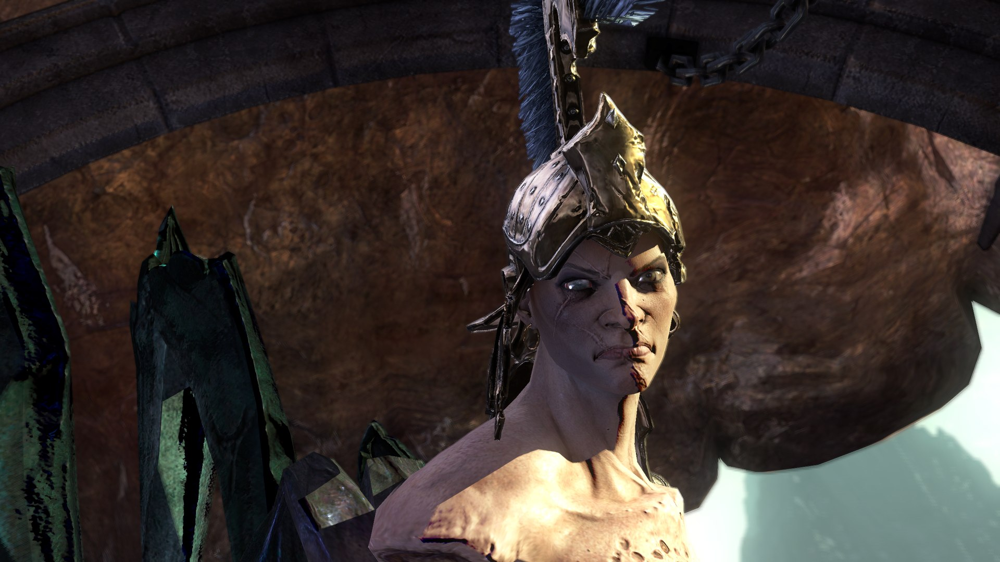
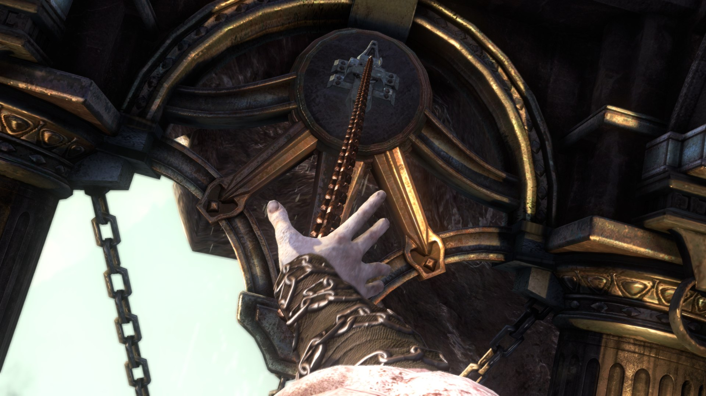
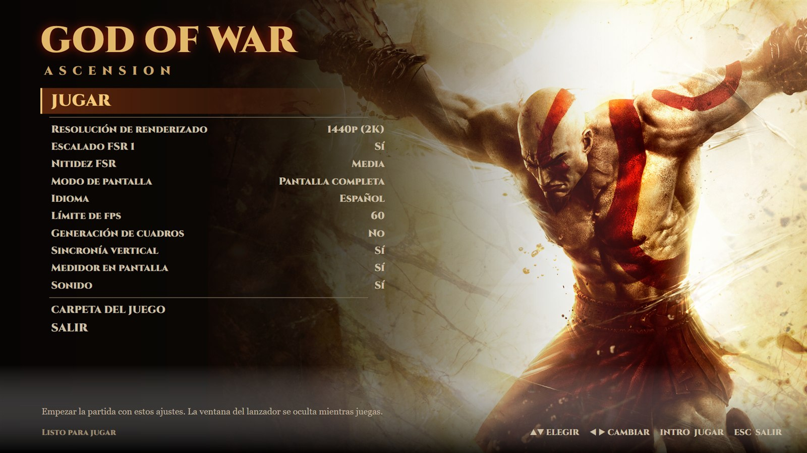

# God of War: Ascension — port nativo para PC (brunoGowAscension)

> **Proyecto de fans, sin ánimo de lucro y sin relación con Sony.** *God of War* es marca registrada de Sony Interactive Entertainment. Este repositorio **no contiene el juego** ni el firmware: necesitas **tu propia copia** del juego. La actualización 1.04 y el firmware oficial del PS3 son **gratuitos** y se descargan de Sony.

[English summary below](#english-summary)

## Qué es

Un port **nativo** de *God of War: Ascension* (PS3, 2013) para Windows. No es un emulador: el código del juego se **traduce a C/C++ y se compila** para tu PC (recompilación estática), sobre el [ps3recomp](https://github.com/sp00nznet/ps3recomp) de sp00nznet. Como el código del juego no se puede repartir, **tu PC genera y compila la parte del juego a partir de tu copia**; el lanzador lo hace por ti.

Esta versión parte del port de [otavix010](https://github.com/otavix010/gow-ascension-pc) (todo su historial está aquí) y añade:

| | |
|---|---|
| **Disco europeo** | Funciona con la copia europea **BCES01741** además de la americana BCUS98232 (el ejecutable es siempre el de la actualización 1.04 americana; los datos, los de tu disco). |
| **Español completo** | Textos, voces y cinemáticas en español (y en inglés, francés y portugués). Antes las cinemáticas salían mudas y en el juego solo se oían efectos con un disco europeo. |
| **Tarjetas AMD** | Arreglados dos fallos de dibujo que solo pasaban en AMD: un triángulo negro tapando la mitad de la cinemática de apertura y manchas en la piel de Kratos (la Furia salía gris). |
| **FSR 1** | Renderizado a 1440p (o la resolución que elijas) escalado a la de tu monitor con FSR 1 (EASU + RCAS). |
| **Generación de cuadros** | El juego sigue a sus 60 fps y en pantalla salen **120 cuadros por segundo**, sin bajar el rendimiento del juego (va en un hilo propio). |
| **Lanzador `GowAscension.exe`** | Con el estilo de los menús del juego. La primera vez pide la carpeta de tu copia y lo prepara todo solo (descarga la actualización y el firmware de Sony e instala lo que falte); después, ajustes y **JUGAR**. |
| **Pantalla completa** | Alt+Intro o F11 pasan de ventana a pantalla completa sin bordes (antes la imagen se congelaba). |
| **Medidor en pantalla** | FPS, resolución, generación de cuadros, modelo de tarjeta gráfica, CPU, GPU y memoria (F10). |

## Cómo jugar

### 1. Lo que necesitas

| Qué | Dónde |
|---|---|
| **El juego**: tu copia del disco de *God of War: Ascension*, europea (BCES01741) o americana (BCUS98232) | Una carpeta que contenga `PS3_GAME`. |
| **La actualización 1.04** (gratuita, ~235 MB) | El lanzador la descarga del servidor oficial de Sony. |
| **El firmware oficial del PS3** (gratuito, ~200 MB) | El lanzador descarga `PS3UPDAT.PUP` del servidor oficial de Sony (o usa el que tengas en RPCS3). No hace falta RPCS3. |
| **Python 3.10+** y **Visual Studio 2022 Build Tools** con C++ y Clang | Si faltan, el lanzador los instala con `winget` (te lo pregunta antes). También vale un LLVM aparte en `C:\Program Files\LLVM`. |

### 2. Descarga la última versión

Baja el `.zip` de la [última versión](https://github.com/serbru20066666/brunoGowAscension/releases/latest) y descomprímelo entero en una carpeta **sin espacios en la ruta** (por ejemplo `C:\Juegos\brunoGowAscension`).

### 3. Abre `GowAscension.exe`

1. **Elige la carpeta de tu copia del juego** (la que contiene `PS3_GAME`).
2. **EMPEZAR**: el lanzador descarga la actualización 1.04 y el firmware de Sony, instala lo que falte y traduce y compila el juego para tu CPU, con el progreso en la ventana. Unos 8 minutos en un PC de 8 núcleos, más en uno de 4. Solo se hace una vez.
3. Ya preparado, muestra los **ajustes** y **JUGAR**. Mientras juegas, el lanzador se oculta y vuelve al cerrar el juego.

Ajustes del lanzador (se guardan en `%APPDATA%\GowAscensionLanzador\ajustes.json`):

- **Resolución de renderizado**: 720p, 1440p, 4K o 2880p.
- **Escalado FSR 1** y su **nitidez**: escala la imagen a la resolución de tu monitor, que se detecta sola.
- **Modo de pantalla**: pantalla completa sin bordes o ventana de cualquier tamaño. Durante el juego, Alt+Intro o F11 alternan.
- **Idioma**: español, inglés, francés o portugués.
- **Límite de fps**: 60, 90, 120 o 30. Jugando, el juego casi nunca pasa de 60 por sí solo (lo frena la CPU), así que 90 y 120 apenas cambian nada; para 120 en pantalla, usa la generación de cuadros. El juego avanza parte de su lógica por cuadro: una escena que pase de 60 va más rápida.
- **Generación de cuadros**: 120 cuadros por segundo en pantalla con el juego a 60. Activada por defecto con monitores de 100 Hz o más.
- **Sincronía vertical**, **medidor en pantalla** (F10) y **sonido**.

**CARPETA DEL JUEGO** cambia a otra copia del disco sin volver a compilar. Las partidas guardadas van a `saves\`; el registro de la última partida, a `out\jogo.log`.

`Lanzador.cmd` abre el mismo lanzador como script de PowerShell. Sin lanzador: `gerar.cmd` (o `gerar.ps1 -Disco ... -Update ... -Firmware ...`) prepara el juego y `jogar.cmd` lo abre; las opciones son variables de entorno (`GOWA_RES_SCALE`, `GOWA_FSR`, `GOWA_FULLSCREEN`, `GOWA_LANG`, `GOWA_FRAMEGEN`, `GOWA_OSD`...). Detalles de la generación: [docs/COMO_GERAR.md](docs/COMO_GERAR.md) (en portugués).

## Rendimiento medido

Fase 1 (la pelea con la Furia), Core i7-14700KF + Radeon RX 6800 XT, monitor 4K a 144 Hz, build sin AVX-512:

| Configuración | El juego | En pantalla |
|---|---|---|
| 720p | ~50 fps | ~50 |
| 1440p + FSR 1 a 4K | ~58 fps | ~58 |
| 1440p + FSR 1 a 4K + generación de cuadros | **59,8 fps** | **120 cuadros/s** |

El límite está en la CPU (el hilo principal del juego). Las CPUs con AVX-512 van bastante más rápido (ver [el README de otavix](docs/README.otavix.pt.md)). En CPUs con núcleos de rendimiento y de eficiencia (Intel 12.ª generación en adelante) la fijación de hilos se desactiva sola: medido, rendía menos.

## Problemas conocidos

- **Tirón la primera vez que entras en cada zona**: los shaders se compilan al vuelo y quedan en caché; la segunda vez desaparece.
- **FSR 4 no**: es el escalado por IA de AMD y solo funciona en las Radeon RX 9000. FSR 2 y 3 necesitan vectores de movimiento que este juego no da; por eso FSR 1.
- El juego completo, de principio a fin, **todavía no está verificado**.

## Licencia y créditos

- **El código y las herramientas: [MIT](LICENSE)**, de otavix010 y colaboradores y, los cambios de esta versión, de Bruno Cardenas Torres.
- **[ps3recomp](https://github.com/sp00nznet/ps3recomp)**, de Ned Heller (sp00nznet), MIT: el traductor, el runtime y el motor de dibujo. Va dentro de `ps3recomp/`.
- **[otavix010](https://github.com/otavix010/gow-ascension-pc)**: el port en el que se basa esta versión (su README original, en [docs/README.otavix.pt.md](docs/README.otavix.pt.md)).
- **`scripts/gpl/unself.py` y `scripts/gpl/pup_libsre.py` son GPL-2.0** (`scripts/gpl/COPYING`): el descifrador de SELF y el extractor del firmware, que siguen el código de [RPCS3](https://github.com/RPCS3/rpcs3) y corren como programas aparte.
- **Claves**: ninguna la hemos creado nosotros. Las de descifrado de ejecutables se leen del código fuente de RPCS3 (`gerar.ps1` descarga `key_vault.cpp/.h` en una versión fija); la KLIC del juego sale de tu propia copia.
- **FSR 1**: implementación propia de los algoritmos publicados de AMD FidelityFX Super Resolution 1.0 (MIT).
- **Fuente Cinzel** (`launcher/Cinzel-Black.ttf`): SIL Open Font License (`launcher/OFL-Cinzel.txt`).
- **[FFmpeg](https://ffmpeg.org)** (LGPL), que `gerar.ps1` descarga de los builds de BtbN, para los vídeos.
- God of War y God of War: Ascension son marcas de Sony Interactive Entertainment. Este proyecto no está afiliado ni respaldado por Sony.

---

## English summary

A **native PC port** of *God of War: Ascension* (PS3) by **static recompilation**, on top of [ps3recomp](https://github.com/sp00nznet/ps3recomp), based on [otavix010's port](https://github.com/otavix010/gow-ascension-pc) (its whole history is kept). **Bring your own copy**: no game code, data or firmware here. This fork adds European disc (BCES01741) support, full Spanish (voices and cinematics), fixes for two AMD-only rendering bugs, FSR 1 upscaling to the monitor's resolution, frame generation on its own thread (the game at 60 FPS and 120 frames/s on screen), Alt+Enter / F11 borderless full screen, an on-screen meter, and a launcher in the game's menu style (**`GowAscension.exe`** in the release zip) that prepares everything on first run: it asks for your disc folder, downloads the free 1.04 update and the official PS3 firmware from Sony, installs missing tools and compiles the game; then it shows the settings and PLAY. RPCS3 is not needed. License: MIT for the code (otavix010 and contributors; this fork's changes by Bruno Cardenas Torres); `scripts/gpl/unself.py` and `scripts/gpl/pup_libsre.py` are GPL-2.0. *God of War* is a trademark of Sony Interactive Entertainment; this is a non-commercial fan project, not affiliated with or endorsed by Sony.
